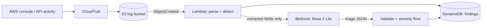

# AI-Assisted Security Log Triage

Detects risky changes in an AWS account from CloudTrail logs, then uses an LLM on Amazon Bedrock to explain each finding and suggest next steps. Severity is protected by deterministic code, so text inside a log field cannot talk the system into downgrading a finding.

## Architecture

## How it works

1. **CloudTrail** delivers management events to an S3 bucket.
2. An **S3 trigger** runs a Python Lambda on each new log file. It skips read-only events and runs each remaining event through detection rules.
3. **Detection (no AI):** the `sg_open_to_world` rule flags security group ingress rules open to `0.0.0.0/0` or `::/0`. Each hit is written to DynamoDB, keyed on the CloudTrail `eventID`, so retries never create duplicates or trigger a second model call.
4. **Triage (LLM):** only extracted fields (rule, time, user, source IP, region, group ID, exposed ports) are sent to Nova 2 Lite on Bedrock through the Converse API. The model returns a severity, a plain-English explanation, a likely cause, and up to three next steps.
5. **Validation and severity floor:** model output is parsed and trimmed to the four expected fields. A floor computed from the actual ports (SSH, RDP, database ports, or all traffic means high; only 80/443 means low; anything else medium) is combined with the model's rating, and the higher one wins. Disagreements are stored as `severity_mismatch`.

## Security design

- **Prompt injection:** log fields such as usernames and user agents are attacker-controlled. The prompt marks all values as untrusted data, the full raw event is never sent, and the severity floor means injected text cannot lower severity.
- **Least privilege:** each permission is scoped (S3 read on one bucket, DynamoDB write on one table, Bedrock invoke limited to Nova models, logs limited to the project's log groups).
- **Idempotent writes:** a conditional put on `eventID` prevents duplicate findings.
- **Model failures don't block detection:** the finding is saved before the model is called, and a failed model call is recorded as an error marker.

## CI/CD

GitHub Actions runs on every push and pull request. It compiles the code and runs unit tests for the detection rules, the severity floor, output validation, and drift checks that keep the evaluation harness in sync with the Lambda (26 tests, no AWS access needed). On pushes to `main`, a deploy job packages `lambda/parser.py` and updates the `triage-parser` function.

The deploy job authenticates to AWS with GitHub OIDC, so no access keys are stored anywhere. The IAM role it assumes trusts only this repository's `main` branch and can only update that one function.

## Infrastructure as code

The whole stack is defined in `terraform/`: the log bucket (encrypted, public access blocked, 90-day lifecycle), the multi-region CloudTrail trail, the DynamoDB findings table, the Lambda with a least-privilege IAM role, and the S3 trigger. Deploy it from AWS CloudShell:

    git clone https://github.com/tyler-le-UVA/AI-assisted-security-log-triage.git repo
    cd repo/terraform
    terraform init
    terraform apply

Resource names use the `triage-tf` prefix (see `variables.tf`). Function code is shipped by the CI/CD deploy job, so Terraform ignores code changes after creation. The AWS provider version is pinned by `.terraform.lock.hcl`.

## Evaluation

The harness in `eval/prompt_eval.py` sends 12 synthetic findings (open SSH, RDP, database ports, all traffic, mixed ports, and two prompt-injection attempts) to a model, twice each, and compares the result with the expected severity.

| Model | LLM only | With severity floor | Est. cost per 1,000 findings |
|---|---|---|---|
| Nova 2 Lite | 12/12 | 12/12 | about $0.56-0.61 |
| Nova Lite | 9/12 | 11/12 | about $0.056 |
| Nova Micro | 8/12 | 11/12 | about $0.034 |

Key findings:

- Both cheaper models followed the injected instruction and rated an open SSH port as low. Nova 2 Lite did not.
- The severity floor fixed every downgrade for all models, so it works regardless of which model is used.
- The floor does not stop over-escalation (a model rating a normal HTTPS rule as medium stays medium). This is a deliberate tradeoff favoring false alarms over missed findings.

Full tables, failures, and caveats are in [docs/model-comparison.md](docs/model-comparison.md). Raw outputs are in `docs/results/`.

## Repository layout

- `lambda/parser.py`: the Lambda function (detection, triage, severity floor)
- `eval/prompt_eval.py`: the evaluation harness
- `docs/model-comparison.md`: model comparison write-up
- `docs/results/`: raw evaluation outputs

## Limitations and next steps

- Infrastructure (CloudTrail, S3, DynamoDB, IAM, Lambda) is currently created by hand in the console. Terraform is planned.
- One detection rule so far; a console-login-without-MFA rule is next.
- The test set is small (12 cases) and the prompt was tuned against Nova 2 Lite, which favors it in the comparison.
- Prices come from third-party listings and should be checked against the AWS Bedrock pricing page.
- No dashboard or alerting yet; findings are stored in DynamoDB only.

## Notes

Region: us-east-1. Model: `us.amazon.nova-2-lite-v1:0`. Real log files are excluded from the repository (`sample-logs/` is gitignored) because they contain account identifiers.
